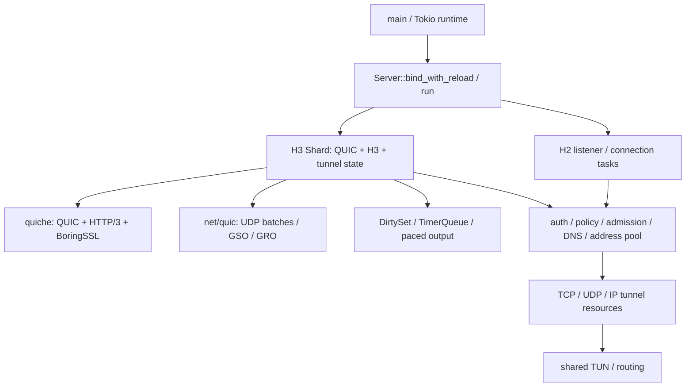
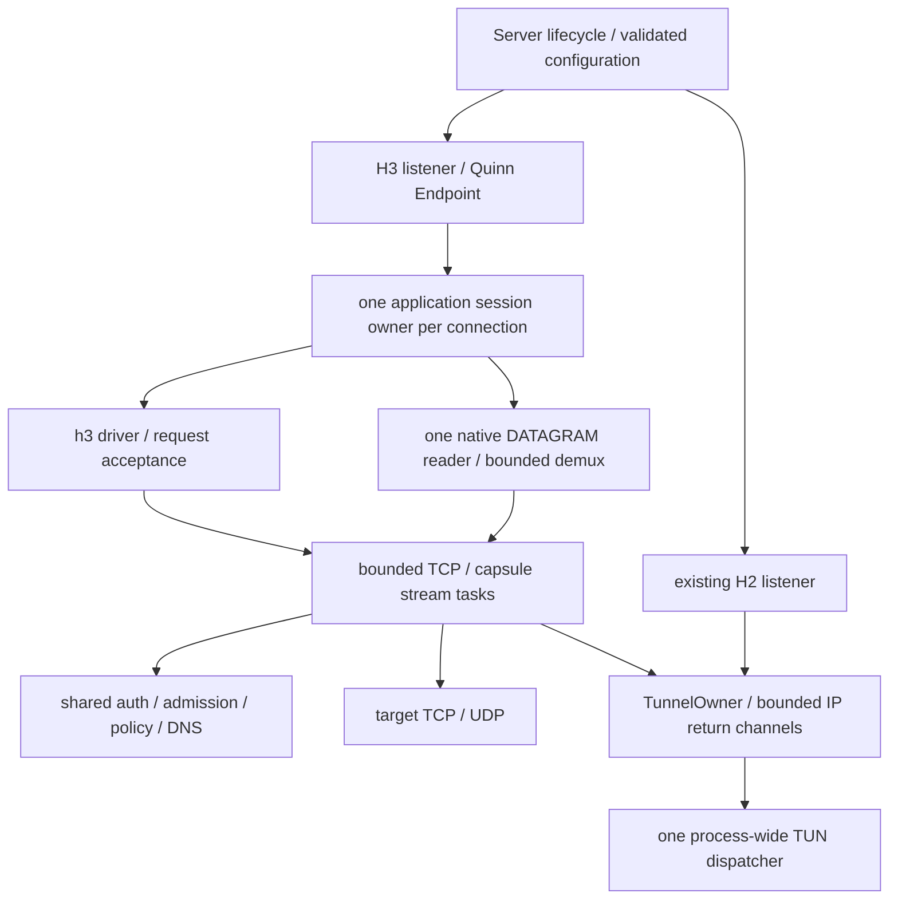

# quiche → Quinn：架构梳理与实施草案

状态：待 review，未修改生产实现。基线为 `origin/main` 的 `63570f6`
（v0.14.23）；工作分支为 `plan/quinn-migration`。
按后续要求，已先完成[裸 QUIC 实验与结果报告](performance-quic-comparison.md)，
再决定是否进入迁移验证。本文中的目录与阶段均为提议。

2026-11-13 选型更新：结合实测和 tokio-quiche 新版源码/依赖检查，当前建议
**保留生产 quiche，优先验证 tokio-quiche，暂不推进 Quinn 迁移**。
统一决策见[后端选型评估](tokio-quiche-evaluation.md)。下文保留为重新考虑 Quinn
时的条件性方案，不代表已决定实施。

## 1. 先回答：server 是不是 Tokio？

**是。** [main.rs](../src/main.rs) 的入口是 `#[tokio::main]`，使用默认的
多线程 runtime；[Cargo.toml](../Cargo.toml) 启用 Tokio `full`。
HTTP/3 与 HTTP/2 都已经运行在 Tokio 上，但连接的组织方式不同：

| 路径 | 当前实现与所有权 |
| --- | --- |
| HTTP/3 | `Server::run` 驱动 `Shard::run`。每个 shard 独占 UDP socket、quiche QUIC/H3 连接、隧道状态、脏连接集合和定时器；用 `tokio::select!` 等待事件 |
| 单 H3 shard、无 H2 | 直接在调用任务中 `await shard.run()`，省去额外任务边界 |
| 多 shard / 多 listener | `JoinSet` 启动各 shard 与 H2 listener；shard 是异步任务，不等同于固定 CPU 核或独占 OS 线程 |
| HTTP/2 | `Http2Listener::run` 接收 TCP，`tokio-boring` 完成 TLS，`h2` 驱动连接；连接与隧道使用有界异步任务 |
| 慢任务 | DNS、Argon2 等通过预算、信号量及阻塞任务隔离；不能阻塞 H3 owner loop |
| 生命周期 | Tokio 任务处理信号、reload、健康检查与有界 drain；共享 TUN 读端目前通常由 H3 shard 0 承担，纯 H2 时另起 dispatcher |

因此迁移的核心是 **QUIC/H3 的驱动方式、状态归属与 TLS 实现**，不是引入 Tokio。
当前 manifest 与 lockfile 均没有 `tokio-quiche`；server 使用自有 shard driver。
裸 QUIC 实验中的 quiche 侧同样是精简自写 Tokio driver，未测试 `tokio-quiche`。

## 2. 当前代码边界

| 模块 | 保留或迁移方式 |
| --- | --- |
| `src/server/mod.rs`, `shard_*.rs`, `connection.rs` | 迁移主体：QUIC/H3 状态、事件、流控、CID、输出调度高度耦合 |
| `src/server/request.rs`, `request_headers.rs`, `http2/request.rs` | 已有可复用的 CONNECT 分类与 IP URI 验证；H3 原始 header 验证及错误映射仍需专门适配 |
| `src/auth.rs`, `admission.rs`, `policy.rs`, `tunnel/resolver.rs` | 优先复用语义与预算，提取必要的公共上下文，不扩大成通用网络框架 |
| `src/server/tls.rs`, `client_identity.rs` | 当前依赖 BoringSSL 对象、回调、SPKI 解析及 ticket generation；不是直接换类型即可复用 |
| `src/tunnel/`, `capsule/`, `datagram.rs`, `routing.rs` | 复用 codec、策略、资源与路由身份；重新连接 H3 I/O。不能同时重复编码 Quarter Stream ID |
| `src/net/quic.rs`, `scheduler.rs`, `net/timer.rs` | 高层 Quinn 路线由其 driver 接手 QUIC 调度；底层 `quinn-proto` 路线需重做适配 |
| `src/net/target_udp.rs`, `tun.rs` | 与外层 QUIC socket 分开，保留独立目标 UDP/TUN 优化与 portable fallback |
| `src/metrics.rs`, `error.rs`, `server/validation.rs` | 去掉公共边界上的 `quiche::PathEvent`、错误类型与常量依赖；指标语义必须明确 |
| `tools/masque-e2e`, `tools/masque-probe`, integration tests | 当前也使用 quiche。第一阶段保留其作为独立互通客户端，不能随 server 同时替换后只测同栈 |

## 3. 若重新推进 Quinn：先验证高层 API，保留退出条件

quiche 同时提供 QUIC 与 H3，Quinn 只提供 QUIC。因此候选组合为
`quinn + rustls + h3 + h3-quinn`，按需要使用 `h3-datagram`。
已核对的上游文档版本为 Quinn 0.11.12、h3 0.0.8、h3-quinn 0.0.10、
h3-datagram 0.0.2；**这不是已通过构建或互通验证的依赖组合**。
正式实施应锁定可共同解析且满足项目 MSRV 的版本。
[Quinn](https://docs.rs/quinn/0.11.12/quinn/)、
[h3 Builder](https://docs.rs/h3/0.0.8/h3/server/struct.Builder.html)、
[h3-quinn](https://docs.rs/h3-quinn/0.0.10/h3_quinn/)、
[h3-datagram](https://docs.rs/h3-datagram/0.0.2/h3_datagram/)。

| 路线 | 收益 | 成本 / 决策条件 |
| --- | --- | --- |
| A：高层 `quinn::Endpoint` + `h3-quinn` | 复用异步 stream、QUIC driver 和现成 H3 adapter，减少自管 QUIC 定时与收发代码 | 应用所有权需要调整；必须证明迁移配额、CID 路由、配置和性能可接受。若重新选择 Quinn，先验证此路线 |
| B：`quinn-proto` + 自有 shard driver + 自建 h3 QUIC adapter | 保留 packet I/O 与 shard 控制权 | 需要处理 Endpoint/Connection 事件、流唤醒、定时、发送与 H3 trait；复杂度明显更高，也不自动解决迁移事件或 BBR2 缺口 |
| 暂不迁移 | 保留已验证的功能和优化 | 如果 A 无法满足硬约束，先 review B 的成本，不以迁移本身为目标强行重写 |

`quinn-proto` 是无网络 I/O 的协议状态机；`h3` 上游仍明确标注 experimental。
这些是选择维护成本与验证范围的依据，不是性能结论。
[quinn-proto](https://docs.rs/quinn-proto/0.11.19/quinn_proto/)、
[h3 项目状态](https://github.com/hyperium/h3#status)。

## 4. 路线 A 的目标结构

建议新增 `src/server/http3/{listener,session,request,tcp,udp,ip,tls}.rs`，
把共有业务语义提取到现有公共模块。初期用明确的后端枚举在 listener 边界选择，
避免将 quiche 的每个 API 镜像成一个巨型 trait。

- Quinn 内部维护 QUIC 状态；应用 session 独占隧道注册表、身份、取消及资源回收。
  不再宣称应用 shard 独占 Quinn 内部连接状态，也不靠全局 Mutex 串行化所有连接。
- 持续驱动 H3 控制流；stream 的目标 I/O 不能阻塞 SETTINGS、GOAWAY 或 DATAGRAM 接收。
  每连接只设一个 native DATAGRAM 消费者，按请求 stream ID 分发到有界队列。
- 先获得 admission / stream permit 再 spawn。TCP 满载时停止读目标，保留半关闭、
  RESET_STREAM/STOP_SENDING 和写 FIN 的语义；UDP 满载有界丢弃，不无限等待或重试。
- DNS 与密码校验的 permit 必须覆盖真实任务生命周期，包括请求取消后仍运行的阻塞调用。
- TUN 调度从“由 H3 shard 0 顺便完成”拆为可独立存活的共享组件；使用进程唯一
  `TunnelOwner`，回收时校验 owner，避免重连覆盖后的旧任务删除新路由。
- 实验后端先只支持单 Endpoint。`shards > 1` 不得静默降为 1；多 Endpoint 必须先证明
  CID steering、Initial 去重、CID 轮换及没有 BPF 时的有界 userspace fallback。

## 5. 必须先解决的兼容性门槛

| 门槛 | 现状与验收 |
| --- | --- |
| BBR2 与旧配置 | 当前默认 `cc_algorithm = "bbr2"`。Quinn 文档列出 experimental `Bbr`，不能当作 BBR2 等价物。裸实验统一 CUBIC；生产默认切换需要单独决策，不能把旧 `bbr2` 静默映射为另一算法 |
| 迁移后的来源 IP 配额 | 当前等到 quiche `PeerMigrated`（路径验证完成）才转移配额。高层 Quinn 的 `remote_address()` 本身不提供同等证明；必须核对实现和时序并写对抗测试，单靠周期轮询不可作为等价方案 |
| 多分片 CID | 现有 CID 含 listener-local socket index、共享别名表和备用 CID；直接开多个独立 Endpoint 不足以保证迁移正确性 |
| HTTP/3 与扩展 | 验证普通 CONNECT、`connect-udp`、`connect-ip`、`cf-connect-ip`、SETTINGS、native DATAGRAM 与 capsule fallback；上游有开关不等于完整 MASQUE 互通 |
| header / 错误语义 | 保留重复认证 header、伪 header 顺序/大小写、标准 CONNECT-IP 的 Authorization、先认证后目标验证、空错误响应 + FIN、流级与连接级错误隔离 |
| 请求 FIN | 即使响应侧因流控尚未结束，客户端 FIN 后也不能继续接受 late native DATAGRAM；保留 early body/auth/setup、局部解析继续推进及 sibling stream 回归 |
| 自签名客户端证书 | 当前按规范化 SPKI roster 认证。Rustls 自定义 verifier 既要查 roster，也必须真正验证 TLS CertificateVerify 签名，不能无条件返回签名成功 |
| TLS / roster reload | 预先构建并验证 H2/H3 两套 TLS 表示，统一发布 generation；失败不改已加载状态。旧连接保留握手身份，后续握手与 Basic 请求采用新快照；撤销与恢复要覆盖 ticket/resumption，继续禁用 0-RTT |
| 流控与内存 | quiche 的初始窗口/自动扩窗上限、按包计的 DATAGRAM 队列，与 Quinn 的窗口/字节预算不是一一对应。逐字段给出显式映射、上界与不支持错误 |
| stream 重组上界 | 裸实验的 LAN stream 已出现一次 `too many gaps in stream buffer` 连接中断。保留失败样本，验证大窗口、丢包/乱序、驱动与上游重组上界的关系；不能通过无界增大缓冲来绕开 |
| 运维语义 | readiness、watchdog、drain、status fingerprint 和指标必须反映真实后端；不能用一个空转心跳掩盖 QUIC driver 卡死，也不能把无法观测的 path event 填为“正常” |

上游核对依据：[拥塞控制](https://docs.rs/quinn/0.11.12/quinn/congestion/index.html)、
[Connection](https://docs.rs/quinn/0.11.12/quinn/struct.Connection.html)、
[TransportConfig](https://docs.rs/quinn/0.11.12/quinn/struct.TransportConfig.html)、
[ClientCertVerifier](https://docs.rs/rustls/0.23.46/rustls/server/danger/trait.ClientCertVerifier.html)。

H3 可以迁移到 Rustls，同时让 H2 暂时继续 BoringSSL；因此第一阶段不能宣称
“已经移除 BoringSSL/C 编译依赖”。证书解析、enrollment 与现有测试客户端也仍有依赖。

## 6. 实施顺序与每阶段交付

| 阶段 | 交付内容 | 通过条件 / 停止条件 |
| --- | --- | --- |
| P0，已测量 | 固定参数裸 QUIC 工具；Mac、Linux、本机与 LAN 双向、四种客户端/服务端组合的重复结果 | 正式矩阵 191/192 完成；保留一次 stream 失败与额外 10 次成功复测。不可外推为生产收益 |
| P1，可行性验证 | 独立、非默认的 Quinn/H3 最小端点；验证 DATAGRAM、client cert、reload、路径验证事件、MSRV、依赖安全与许可证 | 输出明确的可行/需上游补丁/不支持矩阵；关键缺口没有方案时暂停迁移并 review |
| P2，边界提取 | 公共请求语义、资源上下文和 TUN dispatcher；后端无关的错误/指标边界 | quiche 与 H2 原有行为及压力边界不变；每个改动独立 review |
| P3，TCP 与 UDP | Quinn 后端的 CONNECT、流控、半关闭、认证与 native/capsule UDP；保持 quiche 默认 | 现有 quiche 客户端互通；FIN、错误回包受阻、取消、DNS/Argon2 预算回归通过 |
| P4，IP 与生命周期 | CONNECT-IP/TUN、地址/路由回收、双栈/分片、roster/TLS reload、drain 和 readiness | Linux 真 TUN、两种 HTTP transport、热重载成功及失败回滚全部有证据 |
| P5，分片与性能 | CID/migration/admission、多连接公平性、配置映射与优化后基准 | Linux 与 portable fallback 均通过；所有旧配置有保留、拒绝或明确迁移策略；无资源上界回归 |
| P6，默认切换提案 | 汇总报告、默认配置变更、部署/回滚提案；随后才考虑删除旧 server backend | 单独 review 默认切换；通过 operations CLI 做另行授权的 canary 与外部验证；保留前一版本回滚能力 |

P1 前按 `CONTRIBUTING.md` 准备行为与兼容性 issue 文本；本轮不发布 issue。
每阶段以可独立回退的 PR 为单位，不把性能调整、TLS 重写和协议切换揉成一次提交。
暂不承诺工期；P1 的迁移事件/配置兼容性结果决定 A 或 B 的成本。

## 7. 实施验收与 review 决策

按 [testing.md](testing.md) 执行 `scripts/check.sh quick/full`，额外覆盖：

- H2/H3 认证、证书/roster reload、错误响应、header、FIN、TCP backpressure、
  capsule、资源耗尽与配置验证现有测试，保留独立 quiche 客户端。
- Linux `scripts/e2e-test.sh`、CONNECT-IP policy/fragments/FIN、真实客户端 TUN
  forwarding、迁移换端口/换 IP、来源配额、多 shard CID/BPF 及无 BPF fallback。
- parser fuzz、依赖审计、MSRV 1.88、GNU/musl 与 macOS 构建；unsafe 路径改动补 ASan。
- 性能：相同机器和参数交替运行；64/1200 B，单/多连接，固定 offered rate 与饱和两档，
  同时报 goodput、shortfall、RTT、两端 CPU、RSS/队列上界；TCP 加单连接 HTTPS 下载。
  加长 RTT、受控 loss 与 Linux GSO/GRO on/off 后，再讨论生产性能。

建议 review 先决定：目标是减少 QUIC driver 维护成本、移除 C/TLS 依赖，还是提升性能；
这三项需要的工作不同。默认建议保持当前能力为硬约束，先完成 P0/P1，不提前接受
BBR2、多分片或迁移配额的功能退让。性能预算应在 P0/P1 获得可重复基线后确定，
不凭一次测速设定或宣称改善。
