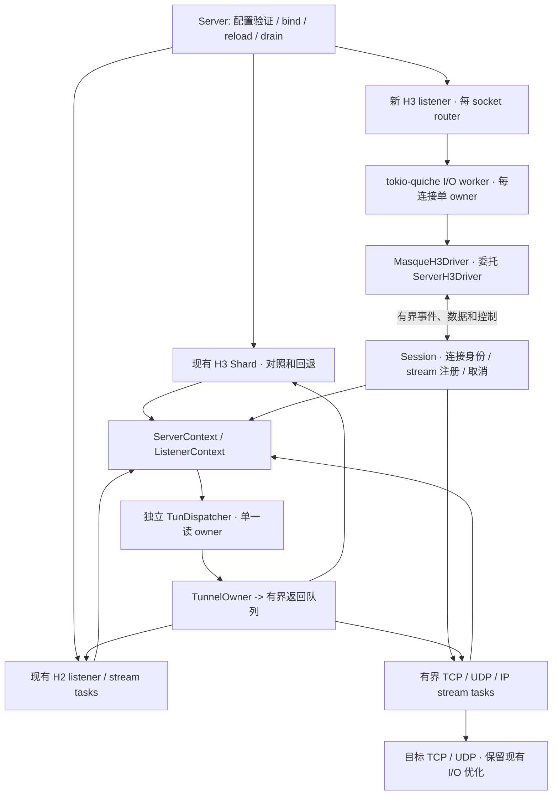

# tokio-quiche 引入计划

状态：P0 已获实施授权，P1 隔离原型已落地，G0 尚未通过，2026-11-13。
生产基线 `63570f6`（v0.14.23），候选库固定为 tokio-quiche 0.23.0 / quiche 0.30.1。
当前实施证据、剩余失败和代码入口见 [G0 实施结果](tokio-quiche-g0-results.md)。
本文的生产模块、配置项、backend Cargo feature 和完整测试矩阵仍是后续阶段目标；
当前生产实现、依赖与部署未变。

相关材料：[现有架构](architecture.md)、[选型评估](tokio-quiche-evaluation.md)、
[协议契约](protocols.md)、[验证矩阵](testing.md)、[裸 QUIC 实测](performance-quic-comparison.md)。

## 1. 决策与兼容性结论

建议以 **保留 quiche/H3/BoringSSL、替换自有 QUIC/H3 driver** 为目标，先引入
非默认后端，与现有 shard 做对照测试。HTTP/2 保留现有 `h2 + tokio-boring` 实现。

**现成 tokio-quiche 0.23.0 不能直接判定为完全兼容的替代品。** 源码已发现 Retry
token、分配前准入、CID 长度、无界控制队列和 stream shutdown 等差异。完整兼容
是实施的验收目标，需要先解决这些差异；尚未完成任何 tokio-quiche MASQUE 互通测试。

| 证据等级 | 当前结论 |
| --- | --- |
| 已完成 | 隔离依赖检查；P1 独立端点及原型补丁；macOS、Linux GNU/musl 最终链接与限定契约实测，详见 G0 报告 |
| 源码确认有接入点 | `ServerH3Driver`、`ApplicationOverQuic`、BoringSSL context hook、同步 path event hook、每 socket CID generator、手动 socket capabilities |
| 已确认存在差异 | 下文 G1–G6；P1 原版通过 7/17 个限定契约，最新补丁版通过 15/17，不能依赖应用外层包装自动消除差异 |
| 尚未验证 | 完整 MASQUE 功能、资源上界、网络性能、真实 MASQUE 客户端、TUN、完整平台矩阵及生产运行 |

“完全兼容”具体要求是：客户端与已有有效配置继续工作，认证/撤销/策略不变，
TCP 背压和半关闭不变，UDP/IP 的丢弃与 FIN 规则不变，资源边界和运维语义有对应证据。
QUIC packet 排布、任务数和内部实现不要求逐字节一致；可观察的协议错误、时序边界
和资源释放必须符合现有测试。**切换后端需要重启和客户端重连，不迁移存量 QUIC 状态，
不承诺现有连接无中断切换。**

若关键能力只能通过长期维护大规模 fork 或重写大部分 H3 driver 实现，停止默认
替换方案，保留现有实现。使用自定义 `ApplicationOverQuic` 而完全自管 H3 是需要
重新评估维护收益的备选，不是自动退路。

## 2. 保留的架构约束

- Tokio 多线程 runtime 继续使用；一个 QUIC connection 仍然只能由一个 I/O owner
  修改。应用任务通过受限接口交互，不持有 `Arc<Mutex<quiche::Connection>>`。
- 认证、DNS、目标连接和阻塞 I/O 不能阻塞 QUIC driver；先拿预算再 spawn。
- 排队数量、持有字节、并发任务、定时器、FD、CID 与路由条目都要有上界。UDP 满载
  有界丢弃，TCP 满载向目标 socket 传播背压。
- 保留 Linux 优化与 portable fallback；升级不得隐式打开 GSO 或改变 BBR2。
- Basic、证书 roster、TLS identity、DNS 预算、来源配额、IP 地址池与策略在两种
  HTTP transport 和两个 H3 后端之间共享，不各建一套限额。
- `server.max_connections` 当前是 **每 H3 shard / 每 H2 listener** 上限；
  `max_connections_per_ip` 才是跨 H2/H3 的进程级来源上限。新后端按每 UDP router
  保留前者语义，不借迁移之机静默改成进程总上限。
- `shards` 继续表示一个 H3 listener 的 socket/router 数量，不代表 CPU 绑核，
  也不表示一条 QUIC 连接可以分到多个核并行处理。

## 3. 目标架构与代码边界



`MasqueH3Driver` 是拟新增的薄适配器：实现 `ApplicationOverQuic`，委托上游 H3
实现，负责握手身份交接、生命周期、预算和必要的协议边界。它不另建 H3 connection，
不在库外再读一次同一条 QUIC DATAGRAM 队列。图中的“有界”依赖 G1 完成，当前
原版 H3 driver 的控制/event 队列不满足这一设计。

建议目录如下。先增加新模块并提取必要公共逻辑，旧 `Shard` 留在原位置，避免
第一阶段同时大规模搬文件和改变行为。

```text
src/server/
  mod.rs                         # 总生命周期、后端选择、共享 reload
  context.rs                     # 从 Shared 提取应用公共资源
  tun_dispatch.rs                # 从 shard 0 / H2-only 路径提取唯一 TUN reader
  authentication.rs              # 复用有界密码验证；拆开 shard 回调部分
  request.rs / request_headers.rs # 复用请求分类与原始 header 校验
  tls.rs / retry.rs              # 保留共享 TLS 和 Retry token 策略
  http2/                         # 原实现，接入公共 context / TUN 返回路径
  http3/
    mod.rs                       # Http3Backend / listener factory
    tokio_quiche/
      listener.rs                # socket/router、bind、准入和 listener 生命周期
      settings.rs                # 从既有配置显式生成库设置
      driver.rs                  # MasqueH3Driver / 上游 API 边界
      session.rs                 # 连接身份、stream 注册、配额和取消
      stream.rs                  # 有界收发、方向状态、错误响应和完成通知
      request.rs                 # 把上游 headers 接到公共认证/分类
      tcp.rs / udp.rs / ip.rs     # 三种隧道的 async 协调
      datagrams.rs                # flow -> stream、Context ID 和 native/capsule 选择
      tls_hooks.rs               # 动态 context、握手身份、迁移同步 hook
      routing.rs                 # CID / router 注册和有界转发适配
      budget.rs                  # 消息、字节、任务和保留内存预算
      lifecycle.rs / metrics.rs  # drain、驱动进展和指标映射
```

| 现有文件/职责 | 拟改动 | 删除条件 |
| --- | --- | --- |
| `server/mod.rs::Shared` | 拆为 `ServerContext`、`ListenerContext` 和旧后端私有状态；公共 context 不含 quiche connection | 不删除公共资源，只移出旧 shard 依赖 |
| `server/mod.rs::Server::bind/run` | 增加 H3 listener enum 分派；bind 全部成功后才 ready，失败撤销已创建任务/socket | 默认切换稳定后再移除旧分派 |
| `server/shard_*.rs`、`connection.rs` | 保留旧后端；借现有测试明确协议契约，不复用包含旧 QUIC 状态的 `ClientConnection` | 新后端全部验收且回滚窗口结束 |
| `server/request.rs`、`request_headers.rs` | 提取纯请求分类、目标验证和拒绝结果；原始重复/大小写信息不能在转成 map 时丢失 | 只删除重复的旧 H3 I/O 适配 |
| `server/authentication.rs` | 保留 `verify_basic_password`、合并验证、取消及 permit 生命周期；结果交给新 stream owner | 旧 shard 结果投递可后删 |
| `server/tls.rs`、`client_identity.rs` | 复用动态证书、SPKI roster、generation 与 ticket 策略，适配新连接身份交接 | 不重写为 Rustls |
| `server/capsules.rs`、`capsule/` | 分离纯解析/控制响应决策与 quiche 写入；新旧后端各有 I/O adapter | 删除旧 I/O 时保留 codec 和预算 |
| `tunnel/tcp.rs` | 提取目标建连、上传背压和带 owner 的 read buffer；旧 relay event adapter 与新 stream adapter 并存 | 不因换 driver 丢掉 ACK 保留内存限制 |
| `tunnel/udp.rs`、`net/target_udp.rs` | 复用目标 socket、批量收发、截断/错误检测和 early-data 预算；换结果接收者 | 不删除目标 UDP fast path |
| `tun.rs`、`routing.rs`、`address_pool.rs` | 保留 TUN/offload、lease 和 owner-safe 回收，统一返回队列注册 | 不删除或改变地址分配规则 |
| `net/quic.rs` | 提取 socket 创建、buffer 设置、CID BPF；收发由新 driver 接管，不能两个 reader 读同一 socket | 仅在证据充分后删除旧 QUIC 收发部分 |
| `scheduler.rs`、`net/timer.rs` | 旧后端继续使用；新后端 QUIC timers/pacing 交给库，应用保留有界 deadline | 旧后端移除且无其他使用者时删除 |
| `metrics.rs`、`runtime_status.rs`、`systemd.rs` | 映射后端/worker 实际状态，保持既有指标和 loaded-config 语义 | 无法获得的值不伪造为零 |
| `tools/masque-e2e`、`tools/masque-probe` | 继续使用 quiche 独立客户端，增加后端矩阵报告 | 不随 server 一起改成 tokio-quiche |

只在 listener 和有限 stream I/O 边界抽象；不把 quiche 每个方法包装成统一巨型 trait。
`CapsuleStream` 等混合 codec/I/O 的类型先拆职责，避免新后端被旧 `ServerQuic` 类型绑住。

## 4. 所有权、数据流与关闭规则

### 4.1 连接与任务

- 每 socket router 负责 ingress、Initial 去重与 CID demux；每连接 I/O worker
  独占 QUIC/H3 状态。`Session` 独占业务 stream 注册表和连接级取消决策。
- `Session` 在拿到 stream/auth/setup 预算后创建任务；每个 `StreamSession` 独占
  本隧道 I/O、decoder 和 lease。Session 保存有界 handle，不与任务共同修改隧道 map。
- 每连接有进程唯一 `ConnectionKey`（延用单调递增 index）、listener/router ID、
  来源 admission guard、握手身份快照和取消信号。CID 只是路由别名，不作为资源身份。
- 准入 guard 从分配前检查贯穿握手、存活、drain 到最终销毁；握手失败、超时、task
  panic、reset 和 shutdown 都必须释放一次。阻塞 DNS/Argon2 的 guard 留到实际工作结束。
- 统一监督 session、stream 与 I/O worker。库内部 spawn 的任务也必须有终止/完成
  可见性；只 Join 应用任务不足以证明释放完毕。需要的 hook 在 G8 中验收。

### 4.2 请求与认证

顺序固定为：保留原始 headers → 语法与重复字段检查 → 请求分类 → Basic 或握手
身份授权 → URI/DNS/目标策略 → 目标资源准备 → `200` → relay。
认证前不创建目标 socket、分配 IP 地址或安装返回路由。库预建的 stream/flow 状态
也计入未认证资源预算，不能因其属于依赖就忽略。

Basic 每请求重新取所属 listener 的有效凭据快照；冷/热缓存、密码验证合并和固定
首次认证期限继续沿用。请求取消只丢弃结果，不能释放仍运行的哈希/解析任务占用的预算。
所有拒绝保持原来的空状态响应、FIN 和错误码，不新增 `Proxy-Authenticate`。

### 4.3 TCP

请求 body 满载时停止消费库 body channel，使 QUIC 接收窗口最终背压客户端；
下行 credit 不足时停止读目标。复用 64 KiB chunk 和现有 per-stream/global
retention 预算，permit 跟随最终 buffer owner，不能在 channel 出队后就释放。
验证 `send_body_zc` 的 clone/ACK 保留路径和退化复制路径均被计账。

方向状态独立：请求 FIN 必须排在所有上传字节后再对目标执行写半关闭；目标 EOF
只关闭响应方向。目标先 EOF 但尚未读完上传时，继续排空上传。RESET/STOP_SENDING
按方向处理，不能把库的“单方向 shutdown”直接当成不会清理另一方向的操作。

### 4.4 UDP / IP、FIN 与两种 DATAGRAM 表达

| 边界 | 编解码责任 |
| --- | --- |
| QUIC DATAGRAM ↔ H3 flow | tokio-quiche 处理 Quarter Stream ID；项目不能重复加/减 |
| flow payload ↔ UDP/IP | 项目处理 Context ID `0`、payload、MTU、认证和目标策略 |
| H3 body ↔ capsules | 项目增量 capsule codec；capsule 值不带 Quarter Stream ID |
| TUN ↔ IP tunnel | 项目处理地址/路由、source spoof 防护、offload 与 owner 校验 |

每 stream 只有一个 DATAGRAM 接收 owner。数据平面需显式记录 `AwaitingAuth`、
`SettingUp`、`Open`、`InputFinished`、`DrainingResponse`、`Closed`；TCP 使用独立
读写方向状态，不能套用 UDP 的 FIN 丢弃规则。

收到请求 EOF 后，同步关闭 native input 门闩；已经完整接收的 pre-FIN capsules
仍按现有语义推进，已有 IP control replies 和响应 FIN 继续在固定 deadline 内发送。
后续 native DATAGRAM 不得续期或在 setup 完成后重放。不能仅依靠对两个 channel 的
`select!` 顺序解决 FIN/Datagram 竞态；需要 driver 侧有序通知/门闩（G6）。

unknown QSID 当前是静默丢弃；上游的 pre-CONNECT pending buffer 必须关闭或适配
到既有语义。已收到 headers 但认证/setup 未完成的报文使用现有 early-data 预算，
并先排查尚未读出的 body FIN/截断，不能直接从库 flow channel 全量重放。

仅在 peer SETTINGS 与 QUIC transport 都允许时发送 native DATAGRAM；否则使用
capsule。native 超 MTU 丢弃，不自动改为可靠 capsule。`FlowShutdown` 会关闭关联
stream，不能用来实现“只停止收 DATAGRAM、仍发送已排队 control reply”。

### 4.5 TUN、reload 与 drain

`TunDispatcher` 负责唯一 TUN reader，返回路由统一为
`TunnelOwner { conn_id, stream_id } -> bounded sink`；旧 H3 sink 可转发到原 shard，
新 H3/H2 sink 送到 stream task。队列满即丢包并记账，不等待某个慢 tunnel。
重连覆盖路由仍是最新 owner 获胜；旧 owner 清理必须匹配 owner，lease 引用计数不变。

保留同一套 `SharedTlsIdentity`、`SharedRoster` 和 Basic 快照发布。TLS hook 在
bind 前准备，不能失败时返回 `None` 而落入默认 context。保留每握手证书选择、
session generation、拒绝 0-RTT、撤销已有连接及失败 reload 回滚。迁移来源配额在
同步 `PeerMigrated` 回调中转移，失败立即关闭连接，业务任务不能在配额失败后继续转发。

SIGTERM/SIGINT：先 not-ready → 停止新连接/请求 → 现有任务有界排空 → 发完允许的
关闭输出 → 取消未完成任务 → 释放 route/lease/permit → Join 完成后退出。TUN reader
最后随其使用者退出；一条连接失败不能误杀其他 listener。backend、socket 和 tuning
变更继续要求 restart，不能借 SIGHUP 切换。

## 5. 实施前必须解决的上游差异

以下位置相对于 tokio-quiche 0.23.0 发布包。**表中新增接口是拟议扩展，不是已经
存在的上游 API**；P1 补丁只实现了其中子集。优先准备最小上游改动；本地 patch 只用于隔离原型，是否接受
临时补丁及维护责任需要在 G0 review 中明确，不默认引入长期 fork。

| 门槛 | 已观察到的差异 | 拟解决方式与通过条件 |
| --- | --- | --- |
| G1 资源有界 | router 的 CID 命令、H3 command/event 都是无界 channel；`BodyBytesReceived` 还会随 body 持续产生事件 | 上游支持容量/字节预算；字节统计合并为 counter，终止状态用有界可合并通知。CID 注册成功才能发布新 CID；注销/close 不能因队列满丢失。暂停 consumer、持续 churn 后内存不增长且恢复后状态正确 |
| G2 分配前准入 | `acceptor::accept_conn` 先创建 quiche connection，router 才 `try_reserve` accept backlog；`handshake_reply` 为每次 stateless reply spawn task | 在分配前加 admission/拒绝 hook，把 guard 移交连接生命周期；Retry/版本协商响应走有界发送预算。保留每 router 上限和跨 H2/H3 来源上限，压力下含所有临时任务均有界 |
| G3 Retry 语义 | `disable_client_ip_validation` 只有开关；内置 token 是 HMAC + 明文 IP/DCID，无 TTL；acceptor 独立随机密钥提供隔离，但未编码本项目的 listener 绑定和 AEAD token 语义 | 注入现有 `RetryTokenCodec` 与 adaptive policy，处理 ODCID/Retry SCID、一致 token 校验和 listener-local 阈值；验证过期、篡改、跨 listener、NAT 换端口及未验证地址不占状态 |
| G4 CID / 多 router | 自定义 generator 可用，但 `short_dcid` 与 Header parser 使用 `MAX_CONN_ID_LEN`（20）；本项目发行 16 B CID；router map 各自独立 | 首选增加可配置 CID 长度并保留 16 B/首字节 socket index；补 shared ownership、CID 发布/退休通知及有界 wrong-router forwarding。20 B 改造仅作为单独 review 的替代，不因可配 generator 就假定 16 B 可用 |
| G5 完整 stream 方向语义 | `ShutdownStream::Read/Write` 最后也调用 `cleanup_stream`；Headers 固定 `fin=false`；FlowShutdown 关闭双向 | 验证并修复仅关闭一个方向时的存活/清理；提供 terminal HEADERS 或等价的空响应完成保证；flow receive-close 与 response drain 分离。通过极小 credit、半关闭、RESET/STOP 和空错误响应测试 |
| G6 native / FIN / framing | 未知 flow 会进 pending buffer；headers 到达即建 flow；FIN 事件与 DATAGRAM 用不同 channel；截断 QSID 与越界 QSID 的错误路径不同 | 可关闭未知 flow buffering、已知 flow 共享 early budget、在接收路径按 FIN 关闭 input。分别验证空/截断/越界 QSID 都是当前 `H3_DATAGRAM_ERROR`，合法未知 QSID/未知 Context ID 静默丢弃；发现偏差需修复后通过 |
| G7 TLS / path hook | hook 存在，但 custom context 依赖同时提供 TLS settings；返回类型不直接传播构建错误；path hook 在 I/O owner 同步调用 | 预构建且失败关闭的 context 交付；握手前禁用 early data，身份进入应用前冻结；保留 CertificateVerify、roster 与 ticket generation。迁移 callback 与资源 guard 有同一个稳定连接身份 |
| G8 生命周期 / 运维 | router/I/O worker 在库内启动；公开 handle 不等于完整 task completion、进展、panic 可观测接口 | 提供可监督的完成/故障和实际 poll/progress 信号；无流量时不误报、driver 停滞时不能仅靠外部心跳继续 ready。shutdown 后无残留 task/FD/路由，真实状态可报告 |

G1 不是仅把 `unbounded_channel` 换成 `channel`：I/O owner 不能 await 消费者造成
连接死锁；数据要按流控处理，必须交付的生命周期事件要合并/保留，CID map 更新要有
发布顺序。关闭/超载策略也不能无区别断掉合法 sibling stream。

G4 不能只接 BPF：必须覆盖 BPF 不可用、迁移落错 socket、重复 Initial 并发创建、
CID 轮换和 retired CID 清理。原型可以先仅支持 `shards = 1`，遇到其他配置明确拒绝；
这只是原型限制，不能带着限制宣称生产完全兼容。

G5/G6 已有独立 peer 的限定复现及部分修补，阻塞 body 后的 FIN/native 顺序仍失败。
详见 G0 报告；目标收到字节/报文、完整流控、认证和资源压力仍须补齐，不能把单个
探针通过计作整个门槛关闭。

## 6. 依赖、配置和安全升级

### 6.1 依赖方案

拟增加可选依赖和 feature，初期默认不编译/启用新后端：

```toml
# 提案，当前 Cargo.toml 尚无这些配置。
[features]
default = []
tokio-quiche-backend = ["dep:tokio-quiche"]

[dependencies.tokio-quiche]
version = "=0.23.0"
optional = true
default-features = false
```

前一轮验证使用默认 features；上面关闭 QLOG 压缩的组合须重新验证。保持当前
拥塞实现，不启用 `gcongestion`、`congestion_window_unchecked_available` 或实验
telemetry；0.23.0 的 `zero-copy` feature 已不是开启零拷贝的必要开关，也不能
为了性能顺手打开它而改变拥塞控制。
[上游 feature 说明](https://docs.rs/tokio-quiche/latest/tokio_quiche/)

需要统一 quiche 0.30.1 与 BoringSSL binding 4.22.0；当前完整副本已证明无需被迫
升到 binding 5.x。libc 由 0.2.191 降为 0.2.189 的候选锁定方案还需要 Linux、
链接和依赖审计；有不可接受的回归或安全约束时，解决上游限制后再继续。

“optional”只控制编译路径，不保证 Cargo.lock 不变：依赖解析和共享 feature
可能影响旧后端。按单独 PR 审查 lockfile、`cargo tree -e features`、许可证、
来源和安全扫描，不用宽范围 `cargo update` 混入无关升级。必要的上游 patch 固定
commit/checksum，附差异清单与回归测试；不依赖浮动分支。

### 6.2 后端选择与配置映射

建议后期增加 listener 字段 `http3_backend = "quiche" | "tokio_quiche"`，省略时
保持 `quiche`。先在测试 harness 显式传后端，再在可运行的实验阶段开放 TOML。
H2 listener 设置该字段时拒绝；未编译对应 feature 时选择新后端应在 `check-config`
报错，不能启动后静默回落。支持不同 listener 使用不同 H3 后端，但同一地址的
reuseport group 不能混用两个后端/认证边界。

原始 TOML 字段用 `Option<Http3Backend>` 保留“未配置”与“显式配置”的区别，
仅在 H3 resolved plan 中补旧后端默认值。序列化和配置编辑时省略 `None`，避免
用户只修改账号却被自动写入旧版本无法识别的新字段。

| 既有配置/行为 | 新后端映射 |
| --- | --- |
| listener 地址、transport、shards、认证、目标限制 | 保留原解析/overlap/ephemeral-port 规则；新 backend 纳入 resolved plan 和 restart fingerprint |
| 每 listener `max_datagram_size` 覆盖 | 同时映射库最大收/发 UDP payload，保留 1200/1350 及其他已支持值；按实时 peer/路径上限计算 payload |
| `cc_algorithm`、initial congestion window | 同名显式映射，默认 BBR2；不继承上游 CUBIC 默认 |
| `initial_max_data`、`initial_max_stream_data` | 映射 connection 与三个 stream 方向；保留 uni stream 数和 H3 控制流配置 |
| `max_connection_window`、`max_stream_window` | 显式映射自动扩窗上限，并纳入内存预算 |
| `enable_dgram`、收发 queue len | 映射 QUIC 层；应用/flow 队列另计，不能用它们掩盖额外缓冲 |
| `enable_udp_gso/gro`、socket buffers | 先创建 socket，按配置构造 capabilities，用 `listen_with_capabilities`；不用会尝试开启全部能力的 `listen` 快捷路径 |
| `discover_pmtu`、pacing | 显式映射；验证 GSO/TXTIME 可用和不可用时的 pacing，保留 portable 行为 |
| `retry_mode`、threshold、TTL | G3 完成后映射现有 token/policy，原型未支持时拒绝相应配置 |
| `max_connections`、`max_connections_per_ip` | 分别每 router 上限与跨 transport 来源 guard；含握手状态，失败立即归还 |
| `max_tunnels_per_connection` | 应用当前存活/等待/错误响应状态的统一预算；不能映射为上游 lifetime `max_requests_per_connection` |
| 首次 Basic 认证、目标 setup、idle、FIN drain deadline | 保留各自开始/结束条件；上游“收到首个 HEADERS”超时不能替代“首次认证成功”期限 |
| active migration、备用 CID、PATH_CHALLENGE 队列、0-RTT | 显式保持允许迁移、当前 CID 数/挑战上界及禁止 early data，不依赖库默认 |
| H3 header/QPACK、扩展 CONNECT | 保留 8192 B field-section 限制、当前 QPACK 设置及扩展协商；不额外接受库支持的旧 CONNECT-UDP method |

新增字段涉及 `config.rs`、`server/validation.rs`、`ConfigReload/ReloadListener`、
`runtime_status.rs`、配置编辑命令、示例配置、文档和 probe/status 能力描述。
后端切换在 reload 时明确报告 restart required，TLS/Basic/roster reload 仍按现有
事务执行。`check-config` 仍不得绑定 socket 或创建 TUN。

**回滚配置必须单独准备。** 当前配置类型使用 `deny_unknown_fields`，旧版本不认识
`http3_backend`；即使值是 `quiche`，也不能假定旧二进制接受。普通示例和默认安装
配置初期不写新字段；切换过的配置必须保存可由旧版本解析的副本，恢复时先验证。

## 7. 逐项功能兼容矩阵

标记“可复用”表示已有代码/接口可用，不表示新后端测试已通过；“需修复/扩展”必须
先过 G0，不能作为已实现兼容性。测试编号对应下一节。

| 契约 | 实施方式 | 当前状态 / 验证 |
| --- | --- | --- |
| H3 ALPN、SETTINGS、原始 headers、非法伪 header/重复认证字段 | 复用 RequestHeaders；新 driver 保留原始 header 序列 | 可复用，待 T1 |
| 标准 TCP CONNECT、目标策略、双栈 DNS、setup 成功后 200 | 复用 target/resolver/policy，接新 stream adapter | 待实现，T2 |
| 双向流控、请求 FIN、目标半关闭、RESET/STOP | 独立方向状态和保留内存预算，解决 G5 | 需验证/修复，T2/T6 |
| CONNECT-UDP native、capsule fallback、大 UDP payload、ICMP/截断错误 | 保留目标 UDP I/O，按 peer 能力选输出路径 | 待实现，T3 |
| malformed QSID 的连接错误、未知 QSID/Context 的丢弃 | 明确 driver 与 Context codec 边界，解决 G6 | 错误路径待实测，T3 |
| pre-CONNECT/未认证/setup 阶段报文及 FIN 后丢弃 | 未知 flow 丢弃，已知 flow 共用既有 early budget，FIN 门闩 | 存在源码差异，T3/T6/T9 |
| CONNECT-IP、cf-connect-ip、配置 aliases、URI 模板与 400/501 | 复用分类/URI 判断，先认证后验证，保持协议优先级 | 可复用，待 T4 |
| ADDRESS_ASSIGN/REQUEST、ROUTE_ADVERTISEMENT、控制包上界 | 复用 IP codec/AddressRequests 和双层输出预算 | 待适配，T4/T6 |
| IPv4/IPv6 TUN、source spoof/目标 policy、分片/offload | 共享 TunDispatcher、既有 tun.rs 和策略 | Linux 待验证，T4/T10 |
| pinned/dynamic lease、重连覆盖、旧连接清理 | 保留引用计数和 `remove_owned`；后端无关 owner key | 待验证，T4/T8 |
| Basic 单/多账号、stealth 404、cache/coalescing/取消 | 复用 SharedBasicAuthenticator 与真实工作生命周期预算 | 可复用，待 T5/T9 |
| client-cert SPKI、TLS alert、签名校验 | 复用自签名 roster 验证 context，握手身份传给 Session | hook 可用，待 T5 |
| TLS/roster/Basic reload、撤销、失败回滚 | 同一共享快照发布与 generation；旧会话身份不重写 | 待 T5/T8 |
| session resumption、reload 后旧 ticket、禁止 0-RTT | 保留 session context 策略；不能接受 replayable CONNECT | 待 T5 |
| Retry off/always/adaptive、token TTL/绑定/隐私 | 注入现有 Retry codec 与 policy | 原版不等价，G3/T7 |
| 分配前上限、来源限制、迁移后来源限制 | admission guard + 同步已验证 path hook | 部分接口缺失，G2/G7、T7/T9 |
| 单/多 listener、shards、CID 轮换/BPF/fallback/Initial 去重 | 保留 socket-index CID 与有界共享注册/转发 | 原版不能直接等价，G4/T7 |
| GSO/GRO、socket buffer、PMTU、BBR2、portable fallback | 显式 settings/capabilities，保留目标 UDP/TUN 优化 | 接口大部分可用，T10/T11 |
| 空错误响应、credit 阻塞、固定 expiry、sibling 隔离 | 64 个 compact pending error 状态 + 真正的完成/取消通知 | G5，T1/T6/T9 |
| readiness/watchdog/status/metrics、SIGTERM 有界退出 | 实际 router/worker 生命周期与应用 owner 联动 | G8，T8/T9 |
| HTTP/2 全部现有行为与资源公平性 | 原路径保留，公共 context/TUN/reload 变化双 transport 回归 | T5/T8/T9/T10，不能因只换 H3 而略过 |

## 8. 资源预算与过载设计

实施前交付一份“每层队列、生产者、消费者、消息数、最大持有字节、满载行为、释放
点”的完整清单，涵盖依赖内部。以下现有限额是回归契约，不把库默认直接加在其上：

| 范围 | 现有预算/约束 | 新后端要求 |
| --- | --- | --- |
| Basic 验证 | 全局 256 排队/运行请求、每连接 16，另有来源和 CPU permit | 新旧 H3 与 H2 共用；取消后真实哈希未结束不能提前归还 |
| DNS | 全局 128、每连接 8，TCP/UDP 共用 | 复用 ResolverBudget，等待计入 setup deadline |
| TCP 上传/下行 | 每 tunnel 上传 1 MiB、目标下行 256 KiB；额外共享 read retention 上限 64 MiB | channel、待发送、部分发送与 ACK 保留的 owner 全部计账；不随 backend 数翻倍 |
| early UDP | 每 tunnel 8 条 / 64 KiB，所有 early tunnel 共用每连接 64 KiB | 库 flow channel 中的未授权数据也计入；未知 flow 不另开 2048 条 pending 储存 |
| capsule 输出 | 每 stream 64 条 / 256 KiB，每连接 256 条 / 1 MiB | 部分写持有原 buffer 的完整费用；IP control 不可被无界数据挤占 |
| capsule 输入 staging | 每连接 64 包 / 256 KiB | codec continuation 与接收 channel 合计受预算约束 |
| pending errors | 每连接最多 64，保留原首次时间；计入 admission | 不能因库已接收 Headers 命令就提前归还；无需保留密码和目标资源 |
| QUIC DATAGRAM | 配置默认收/发各 2048，配置上限各 4096 | 显式映射；新增 flow 队列还需 connection/global byte budget |
| 跨 shard/router 转发 | 每目标 inbox 1024 个逻辑 packet permit | GRO/批次按拆分后的 packet 计数，队列满丢包，转发至多一跳 |
| 控制、CID、定时器、task | 每活跃连接/stream 有限状态，旧 timer 每连接至多一个可替换条目 | 新 timer、ready 通知和任务数按活跃对象有界，完成后可证明归零 |

tokio-quiche 的 ingress queue 默认每连接 2048 个 `Incoming`；GRO 的一个 item
可能含多个 packet。H3 stream channel 在 release 与 debug 的容量也不同，flow
另有 2048 项。因此只数 channel 项数或只做 debug 压力测试不够；G1 必须对 packet、
实际 allocation capacity、同时存活 flow 数与保留 clone 做预算，必要时增加可配置
内部队列和共享 byte budget。

内存模型至少分解为：

```text
进程内存上界 = 共享固定资源
             + 各 socket 的实际内核 buffer / 有界 router 状态
             + 各连接的 QUIC 窗口与重传 / ingress / 控制 / DATAGRAM 预算
             + 各 stream 的 body / capsule / 目标 I/O / lease 状态
             + 全局 DNS、认证和额外 retained-buffer 预算
```

预算必须在申请/读取/复制前取得，buffer 最后一个 owner 释放后归还。满载策略分别
是：TCP 停止读取、UDP/IP 丢包、未开始的 setup/auth 拒绝或在有界期限内等待、控制
状态合并/保留；不能在 I/O owner 等待阻塞 channel，也不能无界重试。新的内部默认
容量及高配置值下的理论总量必须在 G0 review 固定，不能凭一次低并发 RSS 正常放行。

## 9. 测试计划与验收证据

### 9.1 测试组织

现有 quiche 客户端保持独立。把 server fixture 的 backend 参数化，同一条行为
测试分别运行旧 H3 和新 H3；输出必须带 backend，不能 `--features` 编译成功却仍只
跑旧后端。实现数量与失败/忽略清单均记录；只测新库 client/server 自连不算兼容证据。

新旧后端的共同行为沿用同一断言；必要差异只能在明确列出的内部统计中分支，不能
通过把新后端的失败测试 ignore 来通过 CI。新增 race 测试用可控 gate/barrier、
可注入时钟/consumer 停顿，验证不变量，不镜像实现。

| ID | 覆盖范围 | 现有入口及新增要求 |
| --- | --- | --- |
| T0 | 构建、链接、MSRV、依赖、features | pinned toolchain + 1.88；Mac、Linux GNU、x86_64/aarch64 musl；default/新 feature 分别 check/build，最终 release 二进制启动；cargo audit/deny |
| T1 | headers/认证字段/错误响应/协议错误 | `client_cert_connect_ip/request_headers.rs`、`error_responses.rs`、`ip_uri.rs`；核对状态、空 body、FIN、错误作用域和 64 pending 上限 |
| T2 | TCP 背压、半关闭、目标 setup/取消 | `tcp_backpressure.rs`、resolver 单测、实际 CONNECT 下载；极小窗口、慢目标、target EOF 先到、RESET/STOP 与兄弟流字节完整性 |
| T3 | native/capsule UDP、MTU/错误路径 | `udp_capsules.rs`、DATAGRAM codec 测试；增加空/截断/越界 QSID、未知 Context/flow、SETTINGS 协商、目标 ICMP/接收错误、截断检测及大 capsule |
| T4 | CONNECT-IP 语义和路由生命周期 | `client_cert_connect_ip.rs`、IP URI/control 相关测试；地址池耗尽、重复 Request ID、16 KiB 控制值/1024 IDs 上界、pinned reconnect overlap、撤销与 owner-safe 清理 |
| T5 | 认证/TLS/reload/ticket/0-RTT | H2/H3 当前认证和 reload 测试；`session_tickets_never_enable_zero_rtt_connect_requests`；自签名证书、错误签名、删除/改 pinned 地址、热 cache 撤销、失败 reload 后旧服务仍可用 |
| T6 | FIN/解析进展/响应阻塞 | `datagram_fin.rs`、`cold_auth_fin.rs`、`ip_fin.rs`、`error_responses.rs`；冷/热认证、body 隐藏 FIN、256 空 DATA、无后续网络包时仍推进、停止 late native、排空 control/响应 FIN |
| T7 | Retry、准入、迁移、CID/BPF | 现有 Retry/port migration/IP migration/shard 测试；补跨 router 同时 Initial、BPF 强制不可用、CID churn/map queue 满、NAT port 改变、迁移到已满来源、退役后 stale packet |
| T8 | 多 listener/H2 共存/reload/drain/status | `http2_connect`、`check_config`、`add_listener`、`client_config`、`monitoring_assets`、`tests/systemd-shutdown.sh`；新旧 H3+H2 混合，signal/reload/关闭竞态和失败 bind 清理 |
| T9 | CPU/RSS/FD/task/队列上界 | `resource_exhaustion` ignored Linux suite 扩展到新后端，debug/release；暂停 H3 controller、CID consumer、目标接收；洪泛无效 auth、unknown flow、Retry/version reply、慢握手、churn 和取消 |
| T10 | Linux I/O/TUN/分片/portable | Docker E2E、`connect-ip-policy.sh`、`connect-ip-fragments.sh`、`connect-ip-fin.sh`；H2/H3、GSO/GRO/TUN offload on/off、IPv4/IPv6、失败 fallback；Mac 独立覆盖 portable 路径 |
| T11 | 真实业务性能与长期运行 | 下一节矩阵；先 30 分钟 churn/资源恢复，再至少 2 小时混合负载；无 crash、悬挂、资源持续增长或不明连接中断 |

额外 race 检查：流关闭后迟到 setup/auth 结果不能复活资源；最后一个 QUIC buffer
clone 释放前预算仍持有；路由更新后旧 owner teardown 不删除新 owner；FIN、roster
撤销、迁移配额失败和 drain 同时发生时，所有资源只释放一次。日志不能包含密码、
私钥、真实基础设施信息；metrics 不增加每连接/来源地址的高基数标签。

### 9.2 命令与 CI

现在已存在的检查入口：

```sh
scripts/check.sh quick
scripts/check.sh full
cargo test --workspace --release --locked
cargo test --test client_cert_connect_ip --locked
cargo test --test http2_connect --locked
cargo test --test check_config --locked
cargo audit
cargo deny --workspace --locked check licenses sources bans
```

拟新增 `scripts/check.sh full-tokio-quiche` 模式：把同等质量/MSRV/测试流程带上
`tokio-quiche-backend` feature，并验证实际运行了两个 H3 后端的 fixture。该命令
当前尚不可用。CI 的 quality/test/MSRV/release 构建分别加入 feature 矩阵；H2 与
混合后端回归保持必跑，关键兼容性检查不能只留到每周定时任务。

Linux 专项按 [testing.md](testing.md) 在隔离环境执行：

```sh
scripts/e2e-test.sh
cargo test --test resource_exhaustion --locked -- --ignored --nocapture
cargo +nightly fuzz run protocol_parsers -- -max_total_time=180
cargo +nightly fuzz run http3_request_headers -- -max_total_time=60
```

测试 runner 需要把所选新后端传入 Docker/子进程配置；`connect-ip-policy.sh`、
`connect-ip-fragments.sh`、`connect-ip-fin.sh` 和 systemd shutdown 脚本也要各跑
后端矩阵。需要 TUN/NET_ADMIN 的测试只在隔离 Linux 执行，清理 namespace/临时资源。
unsafe socket/BPF/packet 改动补 Linux GNU ASan，遵循现有 scheduled workflow。
交叉编译通过不能代替目标平台运行测试；忽略项、平台限制或缺环境都单独报告。
Linux syscall 检查分别识别外层 QUIC 与目标 UDP：目标 socket 出现 `recvmmsg` /
`sendmmsg` 不能证明新外层 driver 仍有同样的 batching。若外层策略改变，需报告
实际 syscall/CPU 代价并通过性能门槛，不直接宣称原有 fast path 已保留。

### 9.3 性能比较

分开保存四个基线，避免把依赖升级或公共重构收益算到新 driver：

| 基线 | 用途 |
| --- | --- |
| A0 当前生产 quiche 0.30.0 | 产品最终回归基线 |
| A1 同步依赖升级后的旧后端 | 隔离 quiche 0.30.1 / libc / feature 变化 |
| A2 公共 context/TUN 重构后的旧后端 | 隔离公共架构改动 |
| B 同依赖、同公共代码的新后端 | 与 A2 比较 driver，再与 A0 比较实际产品代价 |

先跑完整 MASQUE，再按需要用裸 QUIC 定位瓶颈。测试使用本地 Mac 与局域网 Linux、
双向网络及本机对照；客户端、目标、TLS、CC、窗口、MTU、socket buffer、CPU 配置和
offload 相同。主比较使用生产 BBR2，另做 CUBIC 诊断；不把之前裸实验当作 B 的结果。

- CONNECT：双向大流、短连接 setup、HTTP 下载、慢目标和多 stream 公平性。
- CONNECT-UDP：64/1200 B，native 与 capsule；1/8/32 活跃连接，1/8/64 streams；
  固定 aggregate offered rate 与饱和两档，另有多 idle streams 场景。
- CONNECT-IP：IPv4/IPv6、UDP/TCP inner traffic、真实 TUN forwarding 和 offload。
- 空闲内存与 churn：递增空闲连接数至环境允许的上限，记录每连接增量；测 close
  后 allocator high-water 与持续增长的区别，不能要求 RSS 每次精确归零。
- Linux 受控链路：建议 RTT 0/20/80 ms、loss 0/0.1%/1%，另测乱序/迁移；只在
  隔离 namespace 操作。加独立 UDP/TCP 直连基线和 syscall/profile，识别客户端或 VM 瓶颈。

每个主要组合至少 10 次交替运行，建议 5 秒 warmup + 30 秒统计；轻载延迟另采足够
样本。编译不与测速并行。记录每次 goodput、packet/message rate、p50/p95/p99、
实际发送/回包/超时/无效数、两端 CPU/单位工作、RSS、FD、socket drop、队列 high-water。
保留全部失败和 min/median/max；抖动超过目标容差时结论为不确定，先控制环境再决定。

**拟议性能预算，供本计划 review，不是已经达成的数字：** 主要生产场景吞吐不低于
A0 的 95%，CPU/有效工作不高于 105%，同实际负载 p99 和稳定 RSS 不高于 110%；
H2 也检查公共改动回归。资源硬上界、无泄漏、错误/丢包不被吞吐掩盖是独立硬门槛。
阈值须在看 B 的结果前固定；如需调整，单独解释业务取舍，不在失败后静默放宽。

## 10. 分阶段实施与 PR 划分

前期只交付可回退的小改动。各阶段分别提交源代码、测试和证据，不把 TLS、协议、
默认配置和性能重构揉成一个大 PR。以下阶段不表示当前已获部署或默认切换授权。

| 阶段 | 交付 | 进入下一阶段的条件 |
| --- | --- | --- |
| P0 本计划 | 兼容矩阵、G1–G8、目标架构、预算和测试/性能规则 | review 确认范围及“完整兼容”硬约束；本文可作为 CONTRIBUTING 要求的设计 issue 正文基础，尚未发布 issue |
| P1 G0 可行性验证 | 隔离最小端点；最终链接/Linux 构建；逐项最小复现、公共 API/需 patch/不可行清单；上游差异和队列预算设计 | G1–G8 都有可验证方案；Retry/admission、FIN/半关闭、CID、TLS 是优先停止项。未过则保留旧后端，不大规模重构 |
| P2 依赖和测试骨架 | 可选依赖、锁定版本、backend 参数化 fixture、feature/CI 矩阵；独立评审上游 patches | A0/A1 对照、T0 和旧 H3/H2 全回归；能够证明测试确实选择新 backend |
| P3 公共边界提取 | Server/ListenerContext、纯请求/capsule 边界、统一 TunDispatcher/owner registry；仍使用旧默认 | H2/旧 H3 T1–T10 对应检查通过，A1/A2 无不可接受回归 |
| P4 新 listener/session/TCP | 单 router、身份交接、bounded control、Basic/client-cert、错误响应、TCP 背压/半关闭 | T1/T2/T5/T6 通过；不支持的实验配置明确拒绝；生产默认不变 |
| P5 UDP/IP | native/capsule、early/FIN、目标错误、真实 TUN、地址池/控制 capsule/重连 | T3/T4/T6/T10，两种 transport 的实际 IP forwarding 通过 |
| P6 迁移/分片/生命周期 | adaptive Retry、完整 CID/BPF/fallback、来源迁移、全 reload/drain/metrics/status；可 review 的 listener 选择配置 | T7/T8/T9，通过旧配置完整支持清单；不再有单 shard 原型限制 |
| P7 性能与长期运行 | A0/A1/A2/B 比较、Linux GNU/musl、压力和 soak、客户端互通、维护收益报告 | 所有功能门槛通过，性能预算达标，新增适配/补丁成本小于可删除职责 |
| P8 默认切换提案 | 精确构建产物、配置兼容/恢复方案、canary 范围与外部验证清单 | 单独 review 默认切换与实际运维方案；此时才安排生产 canary |
| P9 删除旧后端 | 按引用移除旧 shard/QUIC scheduler，保留目标 UDP/TUN、共用策略和独立客户端 | 完成约定回滚观察期、有可用前一版本及旧配置；删除单独 PR 再跑完整验证 |

P1 先确定 upstream 改动规模和接受路径，再给后续工程排期。最小 demo 成功不能跳过
G0；等待上游期间可以改进现有代码边界和测试，但不能据此把迁移状态标为可上线。

维护收益报告按职责核算：可删除的 socket/QUIC timer/pacing/H3 driver 代码，减去
新增 adapter、预算/状态机、补丁、依赖与运维负担。单纯搬文件不计收益。若需常年保留
两个生产后端或持续 fork 大量驱动逻辑，重新评估是否值得默认替换。

## 11. 发布、切换与回滚

1. 实验阶段保持 `quiche` 默认，现有配置不受影响。新功能在独立测试 listener/主机
   使用，不能把两个 backend 放到同一个 reuseport group 做“透明混流”。
2. 产物必须经过 feature、MSRV、两种 HTTP transport、Linux musl 安装/systemd
   和外部真实 TCP/UDP/IP 流量验证；握手或 `check-config` 成功不等于隧道可用。
3. 准备精确版本和 checksum、上一版本产物、旧版可读的配置备份及恢复步骤。切换
   使用 restart，预期现有连接断开并重连；ticket/Retry token 不跨进程迁移。
4. 实际 fleet 发布遵循 [AI operations](ai-operations.md) 与项目 `masque-ops`
   Skill/CLI。当前工具没有通用远程配置事务；新 backend 字段的激活/恢复必须有
   单独受支持且已 review 的配置流程，不能假定 release rollout 自动完成它。
5. canary 检查外部三类隧道、H2 回退、认证拒绝/reload、资源和业务指标，再决定扩大。
   发现功能偏差、持续资源增长、driver 停滞或性能越界即停止扩展并按已验证方案恢复。
6. 回滚恢复二进制和兼容配置是两个步骤；`masque-ops rollback` 不恢复任意配置。
   先确认旧二进制能解析恢复配置，再启动并外部验证。旧后端保留期内也可选回旧
   backend 后重启，但共享依赖回归仍可能需要回退整个 release。

所有运维结果区分 planned、applied 和 externally verified；本节发布步骤仍属于
planned。P1 已实施的隔离代码和实验验证见 G0 报告。没有发起 issue/PR 发布、
远端配置修改、服务切换或部署。

## 12. Review 决策清单与完成定义

P0 已授权按以下取舍开始实施；生产采用临时补丁和默认切换仍按对应阶段评审：

- 接受“旧后端默认 + 有限原型 + G0 先行”的顺序，不提前删除 shard。
- 全部既有功能、资源边界、H2 行为为硬约束；不以禁用 migration、降低 shards、
  改 Retry 或扩大无界内存来绕过接入问题。
- 允许在隔离原型使用最小固定 patch；生产采用前明确上游合入/维护责任和退出条件。
- 接受独立 TUN dispatcher、每连接业务 Session、按方向的 stream 状态，以及
  listener 级 backend 选择的目标架构。
- 在 P7 前固定性能容差、实际业务主场景和回滚观察期；默认切换另行评审。

称为“功能完全兼容、可以切换”必须同时满足：矩阵每行有新后端测试证据；G1–G8
全部关闭；旧配置与恢复配置已验证；H2/H3 实际 TUN/流量与 Linux/portable 路径通过；
资源/soak/性能达标；维护收益明确；准确的发布和回滚方案可执行。任何未验证项留在
报告中，不用“底层仍是 quiche”代替证据。

## 13. 源码依据与本轮验证范围

本计划核对本地生产源码及 crates.io 下载的 tokio-quiche 0.23.0 发布包。主要
上游审阅位置：`quic/router/{mod,acceptor}.rs`、`quic/addr_validation_token.rs`、
`quic/io/worker.rs`、`quic/connection/{mod,id}.rs`、`quic/hooks.rs`、
`http3/driver/{mod,server,streams,datagram}.rs`、`settings/{quic,config}.rs`、
`socket/{listener,capabilities}.rs`。线上文档用于核对公开 API，发布包源码决定细节。

- [tokio-quiche 0.23.0 发布包](https://crates.io/crates/tokio-quiche/0.23.0)
- [公开 API 与 feature](https://docs.rs/tokio-quiche/latest/tokio_quiche/)
- [router 源码](https://docs.rs/crate/tokio-quiche/0.23.0/source/src/quic/router/mod.rs)
- [H3 driver 源码](https://docs.rs/crate/tokio-quiche/0.23.0/source/src/http3/driver/mod.rs)
- [Retry token 源码](https://docs.rs/crate/tokio-quiche/0.23.0/source/src/quic/addr_validation_token.rs)

P0 规划阶段的 macOS 依赖检查见选型评估；下列是当时的规划文档和旧后端检查，
不能计作新后端兼容性通过。后续 P1 的代码、构建和平台实测见
[G0 实施结果](tokio-quiche-g0-results.md)。P0 验证结果：

- `scripts/check.sh quick` 与 `scripts/check.sh full` 均通过；full 使用临时 PATH
  选择 Python 3.11，包含格式、Clippy、ShellCheck、安装/运维脚本、MSRV 和 workspace
  测试。Rust 测试 672 项、Python 测试 103 项通过，未改动系统 Python 配置。
- 文档本地链接、表格列数、代码围栏、空白和 G/T/P 编号完整性检查通过。
- `Cargo.toml`、`Cargo.lock`、`src/`、`tools/` 相对当前 HEAD 无改动。

完整新后端互通、性能、资源压力和部署验证仍待执行；P1 已运行的 Linux 协议探针
不能代替这些验收项。
